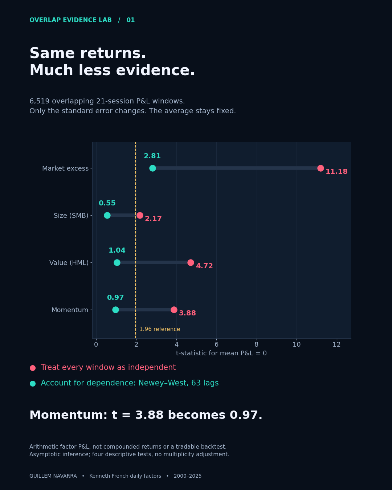

# Overlap Evidence Lab

How much historical evidence is left when adjacent return windows reuse almost
all their daily observations?

Using Kenneth French daily US factors over 2000–2025, the mean of 6,519
overlapping 21-session momentum P&Ls has a naive t-statistic of **3.88**.
The same sample and mean give **0.97** with a pre-specified Newey–West/Bartlett
standard error using 63 lags. Across market excess, size, value and momentum,
dependence-aware standard errors are **3.95–4.53 times** the naive estimates.

This is an inference experiment on observed research factors, not a new trading
strategy. It neither establishes absence of a factor premium nor predicts net
returns. The 1970–1999 reference, for example, has a momentum HAC t of 4.43.



## Design

The [research design](RESEARCH_DESIGN.md) was saved before examining results.
Four factors are retained, with no search for the most favorable factor or period:

- Historical reference: 1970–1999.
- First evaluation: 2000–2019; later replication: 2020–2025.
- Primary combined evaluation: 2000–2025, explicitly pre-specified.
- Each label is the arithmetic sum of 21 daily factor returns, constant daily
  notional. Labels stay entirely within the relevant period.
- Same overlapping observations and mean for iid and HAC calculations.
- Sensitivities: horizons 1/5/10/21/63, bandwidths 20/42/63/126 at h=21,
  every one of 21 disjoint-window offsets, and circular daily block bootstrap
  with 2,000 draws at each of 21/63/126-session block lengths.

## Reproduce

Python 3.11+ recommended. The exact execution environment is saved in
[results/environment.json](results/environment.json).

```bash
python3 -m venv .venv
source .venv/bin/activate
python3 -m pip install -r requirements.txt
python3 research.py
python3 verify.py
MPLCONFIGDIR=/tmp/overlap-matplotlib python3 plots.py
python3 report.py
```

The checked-in `data/daily_factors.csv` makes the published results reproducible
without network access. `python3 research.py --download` fetches a fresh source
snapshot and replaces data/results; future revisions can change the numbers.
Do not use that option when reproducing this specific snapshot.

## Outputs

- [Full computed report](results/report.md), including every chronological slice
  and sensitivity, [primary windows](results/primary_windows.csv), and
  [statistics](results/statistics.csv).
- [Mean and interval figure](results/figures/02_intervals.png).
- [Horizon sensitivity figure](results/figures/03_horizon_sensitivity.png).
- [Sliding-window animation](results/figures/overlap_window.gif) using observed
  daily momentum returns in a fixed early-2020 segment. The animation explains
  reused observations, rather than simulating trades.
- [Independent verification](results/verification.json): every primary window
  reconstructed directly, independent covariance calculation, and statsmodels.

## Interpretation

Daily overlapping 21-session windows share 20 returns. More rows do not add
independent information at the same rate. Correcting standard errors does not
change the measured mean, but it can change how much evidence supports it.
Disjoint sampling is a useful diagnostic; selecting a favorable start offset
would introduce another research choice, so all offsets are reported.

The values in these figures are unconditional mean-P&L tests. Predictive
regression residuals may have different dependence. There is no universal
instruction to divide every t-statistic by sqrt(21).

## Sources and limitations

Daily data: [Kenneth French Data Library](https://mba.tuck.dartmouth.edu/pages/faculty/ken.french/data_library.html),
[US factor definitions](https://mba.tuck.dartmouth.edu/pages/faculty/ken.french/Data_Library/f-f_factors.html),
and [daily momentum definition](https://mba.tuck.dartmouth.edu/pages/faculty/ken.french/Data_Library/det_mom_factor_daily.html).
The source archives use the August 2026 CRSP database snapshot, downloaded
20 October 2026 and restricted to 1970–2025. Provenance and checksums are in
[data/manifest.json](data/manifest.json). Original archives are retained locally
but excluded from Git; the extracted, common-date factor series is included.
Factor data are attributed to Kenneth French and their upstream providers.

For methodological context see [Hedegaard and Hodrick, 2014,
*Estimating the Risk-Return Trade-off with Overlapping Data Inference*](https://www.nber.org/papers/w19969).
This experiment uses a much simpler unconditional mean test, not that paper's
predictive specification.

HAC intervals are asymptotic mean ± 1.96 SE. They are not exact finite-sample
coverage guarantees, and the four-factor display is not multiplicity-adjusted.
Nonstationarity, serial dependence, tails and bandwidth affect inference.
Current revised research factors do not recreate point-in-time tradable
holdings. No costs, financing assumptions, executions or future profitability
are estimated. Arithmetic summed P&Ls are not compounded returns.

Code is MIT licensed. Upstream data retain their providers' applicable terms;
the code license does not relicense source data.
